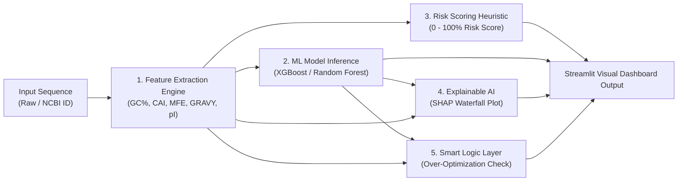

# 🚀 SynthBio Execution & Results Guide

This document provides step-by-step instructions on **how to run SynthBio** (via Streamlit web application and command-line pipeline) and details **what results to expect when gene sequence data enters the system**, featuring a real test benchmark using NCBI Accession `M15077.1`.

---

## 🛠️ 1. How to Run SynthBio

### Option A: Interactive Streamlit Web Application (Recommended)

Launch the interactive graphical user interface using your active Python environment:

```powershell
python -m streamlit run app/main.py
```

- **Default URL**: `http://localhost:8501`
- **Features Available**: Sequence text input, NCBI Accession fetching, metric displays, risk badges, SHAP Waterfall visualizations, and Over-Optimization alerts.
- **Troubleshooting**: If you see `"⚠️ SHAP library is not installed"`, ensure you run the app using `python -m streamlit run app/main.py` to ensure it uses the Python environment where `shap` is installed.

---

### Option B: Command-Line Machine Learning Pipeline

Train the baseline model, run $K$-Fold cross-validation, evaluate performance metrics, and export model artifacts:

```powershell
python -m src.pipeline
```

- **Output Artifact**: Serializes model to [`models/baseline_model.joblib`](file:///d:/UDEEPA/Projects/SynthBio/models/baseline_model.joblib).

---

### Option C: Dataset Feature Extraction

Batch process raw DNA CSV datasets to compute GC%, CAI, MFE, GRAVY score, and Isoelectric Point (pI):

```powershell
python -m src.data_processing --input data/raw/sample_sequences.csv --output data/processed/feature_table_boel_5features.csv
```

---

### Option D: Automated Unit Test Suite

Execute quality assurance unit tests:

```powershell
python -m pytest tests/
```

---

## 🔄 2. What Happens When Data Enters SynthBio?

When a synthetic gene construct (DNA sequence string or NCBI Accession ID) enters SynthBio, the system processes it through a 5-stage automated pipeline:



### Stage 1: Feature Extraction
The sequence is cleaned and validated, and 5 biophysical features are computed:
1. **GC Content (`gc_content`)**: Percentage of G and C bases ($45-55\%$ is optimal for *E. coli*).
2. **Codon Adaptation Index (`codon_adaptation_index`)**: Measures codon usage alignment against *E. coli* K-12 codon frequency tables.
3. **mRNA Folding Stability (`mrna_folding_stability`)**: Calculates 5' secondary structure minimum free energy ($\text{MFE} \, \Delta G$ in kcal/mol). Tighter folding ($<-15 \text{ kcal/mol}$) impedes ribosome binding.
4. **GRAVY Score (`gravy_score`)**: Grand Average of Hydropathicity of the translated amino acid sequence ($<0$ hydrophilic, $>0$ hydrophobic).
5. **Isoelectric Point (`pI`)**: Net electrical charge equilibrium pH.

### Stage 2: Machine Learning Prediction
The feature vector is passed to the trained gradient boosted model (`models/baseline_model.joblib`) to predict:
- **Predicted Expression Tier**: Tier 0 (Very Low) through Tier 5 (Very High).
- **Estimated Yield**: Estimated expression output level (Arbitrary Units / AU).

### Stage 3: Construct Failure Risk Calculation
A continuous failure risk score ($0.0\% - 99.9\%$) is computed based on biophysical boundary penalties:
- **GC Penalty**: Deviation outside $40-60\%$.
- **CAI Penalty**: Unfavorable codon usage ($\text{CAI} < 0.70$).
- **MFE Penalty**: Strong 5' mRNA secondary hairpins ($\text{MFE} < -12.0 \text{ kcal/mol}$).

### Stage 4: Explainable AI (SHAP Waterfall Plot)
`shap.TreeExplainer` measures local feature attribution, rendering a waterfall plot that visualizes how each individual feature pushes expression risk higher (red bars) or lower (blue bars).

### Stage 5: Smart Logic & Trap Detection
Checks for the **Over-Optimization Trap** ($\text{CAI} > 0.85$, predicted tier $\le 2$, $\text{MFE} < -15.0\text{ kcal/mol}$), warning users if excessive codon optimization has created ribosome-blocking mRNA structures.

---

## 🧪 3. Benchmark Test Case: NCBI Accession `M15077.1`

### Overview of Test Sequence
- **Accession**: [`M15077.1`](https://www.ncbi.nlm.nih.gov/nuccore/M15077.1)
- **Organism / Gene**: *Escherichia coli* transposon Tn9 chloramphenicol acetyltransferase (`cat`) gene locus.
- **Sequence Length**: **2,387 base pairs (bp)**.

---

### How to Test Accession `M15077.1` in the Streamlit UI

1. Run `streamlit run app/main.py`.
2. In the **Input Gene Sequence** card, select the **🌐 NCBI Accession ID** tab.
3. Enter `M15077.1` into the accession text box.
4. Click **🚀 Analyze & Predict Expression**.

---

### Empirical Output Results for `M15077.1`

When `M15077.1` enters SynthBio, the following exact numerical results are produced:

#### 1. Extracted Sequence & Protein Features
| Feature Name | Value | Status / Interpretation |
| :--- | :--- | :--- |
| **Sequence Length** | `2,387 bp` | Full nucleotide locus |
| **GC Content (%)** | `41.22%` | Satisfactory (Within acceptable $40-60\%$ range) |
| **Codon Adaptation Index (CAI)** | `0.399` | Low (Unoptimized natural transposon sequence) |
| **mRNA Folding Stability (MFE)** | `-20.84 kcal/mol` | Very Strong Folding (Potential 5' ribosome binding hindrance) |
| **GRAVY Score** | `-1.2000` | Hydrophilic protein |
| **Isoelectric Point (pI)** | `8.75` | Slightly basic protein |

#### 2. Model Prediction & Risk Score
| Metric | Result | Visual Indicator |
| :--- | :--- | :--- |
| **Construct Failure Risk Score** | **35.7%** | 🟧 **Moderate Failure Risk** |
| **Predicted Expression Tier** | **Very Low (Tier 0)** | Low expression tier |
| **Estimated Expression Yield** | **10.0 AU** | Baseline minimum yield |

#### 3. Risk Penalty Breakdown Calculation
$$\text{Total Risk Score} = \text{Penalty}_{\text{GC}} + \text{Penalty}_{\text{CAI}} + \text{Penalty}_{\text{MFE}}$$
- **GC Penalty**: $0.0\%$ (41.22% is within the $40.0\% - 60.0\%$ threshold).
- **CAI Penalty**: $(0.700 - 0.399) \times 60.0 = \mathbf{18.06\%}$ (High penalty due to low CAI).
- **MFE Penalty**: $|-20.84 + 12.0| \times 2.0 = \mathbf{17.68\%}$ (High penalty due to strong secondary structure).
- **Final Risk Score**: $18.06\% + 17.68\% = \mathbf{35.74\% \approx 35.7\%}$.

#### 4. Feature Importance & SHAP Contributions
| Feature | Importance Weight | Impact on Prediction |
| :--- | :--- | :--- |
| **GC Content (%)** | `0.228` | High baseline influence |
| **mRNA Folding Stability (MFE)** | `0.208` | Primary driver increasing failure risk |
| **Codon Adaptation Index (CAI)** | `0.140` | Secondary driver increasing failure risk |
| **GRAVY Score** | `0.130` | Moderate protein influence |
| **Isoelectric Point (pI)** | `0.063` | Minor contribution |

---

## 💡 4. How to Interpret Results & Take Action

When analyzing construct results in SynthBio:

1. **Risk Score Badges**:
   - 🟩 **Low Risk (<30%)**: Construct is well balanced and safe for synthesis.
   - 🟧 **Moderate Risk (30–60%)**: Review penalty breakdown (CAI or MFE folding). Optimization recommended.
   - 🟥 **High Risk (>60%)**: High likelihood of synthesis or expression failure.
2. **Actionable Recommendations for `M15077.1`**:
   - **Codon Optimize**: Increase CAI from `0.399` toward `0.75-0.85` using *E. coli* preferred codons to boost translation elongation speed.
   - **MFE Secondary Structure Relaxation**: Modify synonomous codons in the 5' region (first 48 bp) to reduce folding tightness ($\text{MFE} > -12.0 \text{ kcal/mol}$), freeing up the Shine-Dalgarno / start codon site for ribosome entry.

---

## 💻 5. Terminal Logging & Diagnostic Output Guide

SynthBio includes structured terminal logging (`[SynthBio.<module>]`) across all features, models, predictions, XAI modules, and Streamlit interfaces. This allows developers and synthetic biologists to track pipeline execution and immediately locate failure points from the terminal console.

### Sample Terminal Logs: Successful Prediction Pipeline
```text
20:57:01 [INFO] [SynthBio.app] Initializing Streamlit Application Page Configuration...
20:57:01 [INFO] [SynthBio.app] Checking for trained model artifact at 'd:\UDEEPA\Projects\SynthBio\models\baseline_model.joblib'...
20:57:01 [INFO] [SynthBio.model] Loading trained model artifact from 'd:\UDEEPA\Projects\SynthBio\models\baseline_model.joblib'...
20:57:01 [INFO] [SynthBio.model] Successfully loaded model artifact: XGBClassifier
20:57:01 [INFO] [SynthBio.model] Initializing SHAP TreeExplainer for model...
20:57:01 [INFO] [SynthBio.model] SHAP TreeExplainer initialized successfully.
20:57:05 [INFO] [SynthBio.app] Triggering prediction workflow for input sequence length 2387 bp...
20:57:05 [INFO] [SynthBio.predict] Starting construct prediction pipeline for input sequence (2387 bp)...
20:57:05 [INFO] [SynthBio.features] Extracting features for sequence length 2387 bp...
20:57:05 [INFO] [SynthBio.features] Feature Extraction Summary -> GC: 41.22%, CAI: 0.399, MFE: -20.84 kcal/mol, GRAVY: -1.2, pI: 8.7501
20:57:05 [INFO] [SynthBio.predict] Computing construct failure risk penalties for GC=41.22%, CAI=0.399, MFE=-20.84 kcal/mol...
20:57:05 [INFO] [SynthBio.predict] Risk Penalties -> GC Penalty: 0.0%, CAI Penalty: 18.1%, MFE Penalty: 17.7% => Total Risk Score: 35.7%
20:57:05 [INFO] [SynthBio.predict] Executing ML model prediction on construct features...
20:57:05 [INFO] [SynthBio.predict] ML Model Output -> Predicted Tier Score: 0 (Very Low (Tier 0)), Yield: 10.0 AU
20:57:05 [INFO] [SynthBio.xai] SHAP Waterfall plot rendered successfully in Streamlit UI.
20:57:05 [INFO] [SynthBio.app] Prediction Complete -> Risk: 35.7%, Tier: Very Low (Tier 0), Yield: 10.0 AU
```

---

### Sample Terminal Logs: NCBI Fetch Failure Diagnosis
```text
21:01:00 [INFO] [SynthBio.features] Attempting NCBI Entrez fetch for Accession 'INVALID_ACC_9999'...
21:01:00 [WARNING] [SynthBio.features] Bio.Entrez fetch failed for 'INVALID_ACC_9999': HTTP Error 400: Bad Request. Attempting HTTP eutils fallback...
21:01:01 [ERROR] [SynthBio.features] Failed to fetch sequence from NCBI for accession 'INVALID_ACC_9999': HTTP Error 400: Bad Request
21:01:01 [ERROR] [SynthBio.app] NCBI accession lookup failed for 'INVALID_ACC_9999': Failed to fetch sequence from NCBI for accession 'INVALID_ACC_9999'
```

---

### Key Terminal Indicators to Check When Debugging
- **`[SynthBio.model]`**: Look for `Unpickling Warning` or `Model file does not exist` if model artifacts fail to load due to scikit-learn version mismatches.
- **`[SynthBio.features]`**: Look for `Sequence length too short` or `Protein feature extraction failed` if malformed DNA inputs are provided.
- **`[SynthBio.xai]`**: Look for `SHAP library is not installed` if `shap` fails to import or render waterfall plots.
- **`[SynthBio.predict]`**: Check `Risk Penalties` lines to inspect exact breakdown of GC, CAI, and MFE score deductions.

---

