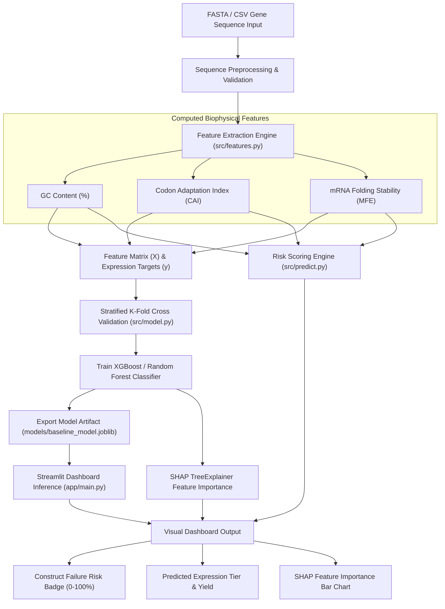

# 🔄 End-to-End System & Data Flow Architecture

## 🌊 Pipeline Execution Flowchart

---

## 🔁 Stage-by-Stage Pipeline Lifecycle

### Stage 1: Data Ingestion & Validation
1. Pipeline checks for [`data/processed/feature_table.csv`](file:///d:/UDEEPA/Projects/SynthBio/data/processed/feature_table.csv).
2. If missing, synthetic fallback sequence data is generated automatically.
3. Dataset shape, missing values (nulls), and numeric data types are validated.

### Stage 2: Data Splitting
1. Stratified 80/20 train/test split is performed (`split_data`).

### Stage 3: Stratified K-Fold Cross-Validation
1. 5-Fold Stratified Cross-Validation evaluates generalization performance across small training samples.
2. Mean Accuracy and Macro F1 scores are printed to console logs.

### Stage 4: Final Model Training & Evaluation
1. Model is fit on full training dataset.
2. Predictions are evaluated on the 20% test set.
3. Classification metrics (Accuracy, Precision, Recall, F1) are printed.

### Stage 5: Model Artifact Serialization & Web Serving
1. Model artifact is serialized using `joblib` to `models/baseline_model.joblib`.
2. Streamlit app ([`app/main.py`](file:///d:/UDEEPA/Projects/SynthBio/app/main.py)) loads cached model artifact via `@st.cache_resource`.
3. User sequence inputs trigger real-time feature extraction, ML inference, risk calculation, and SHAP visualization.
