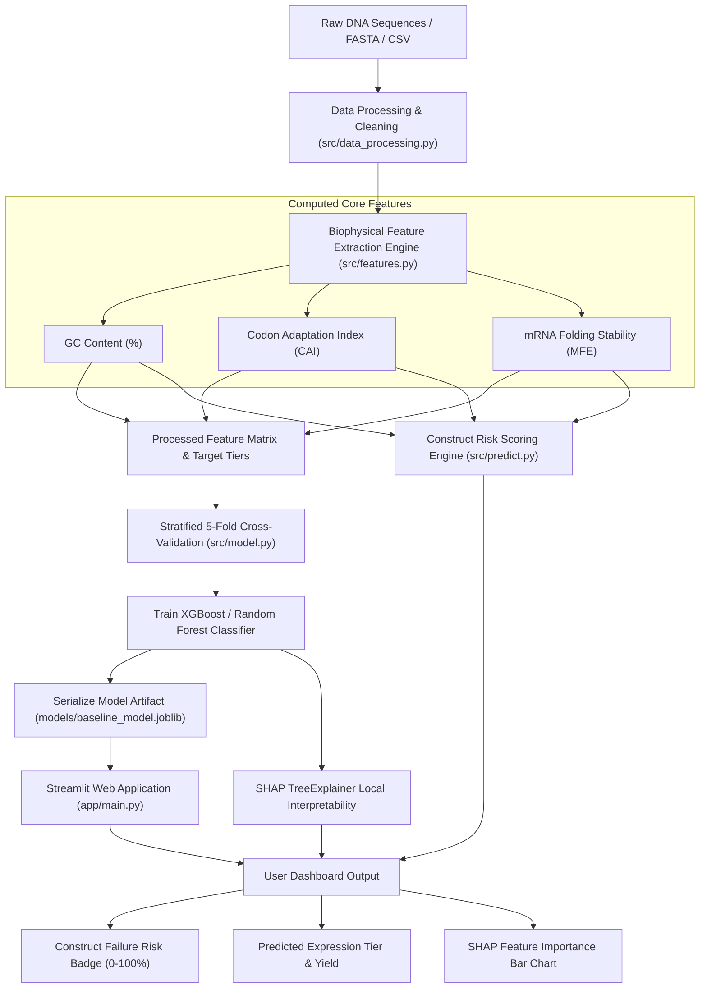
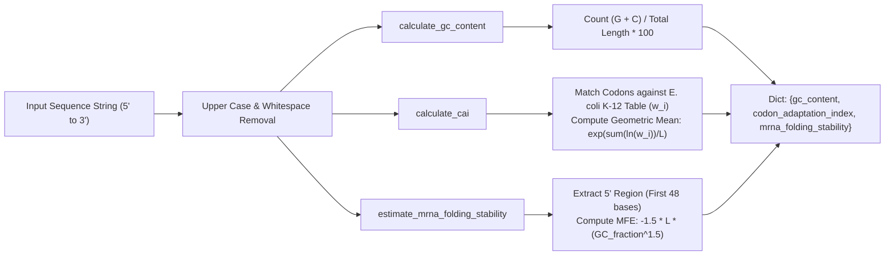
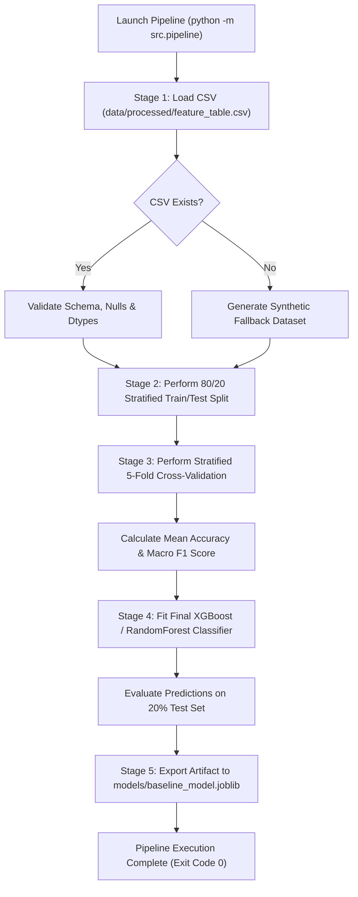
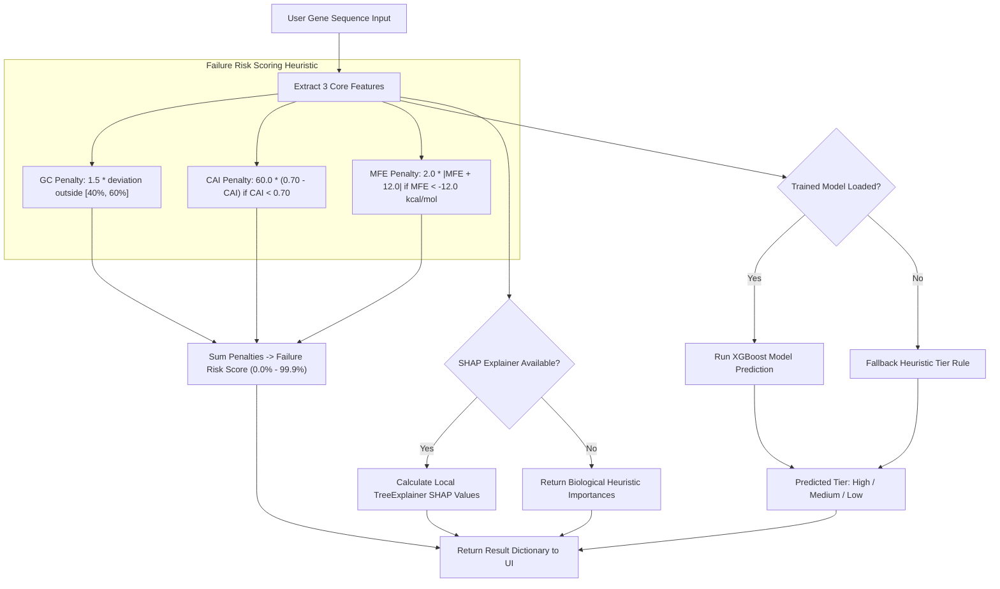
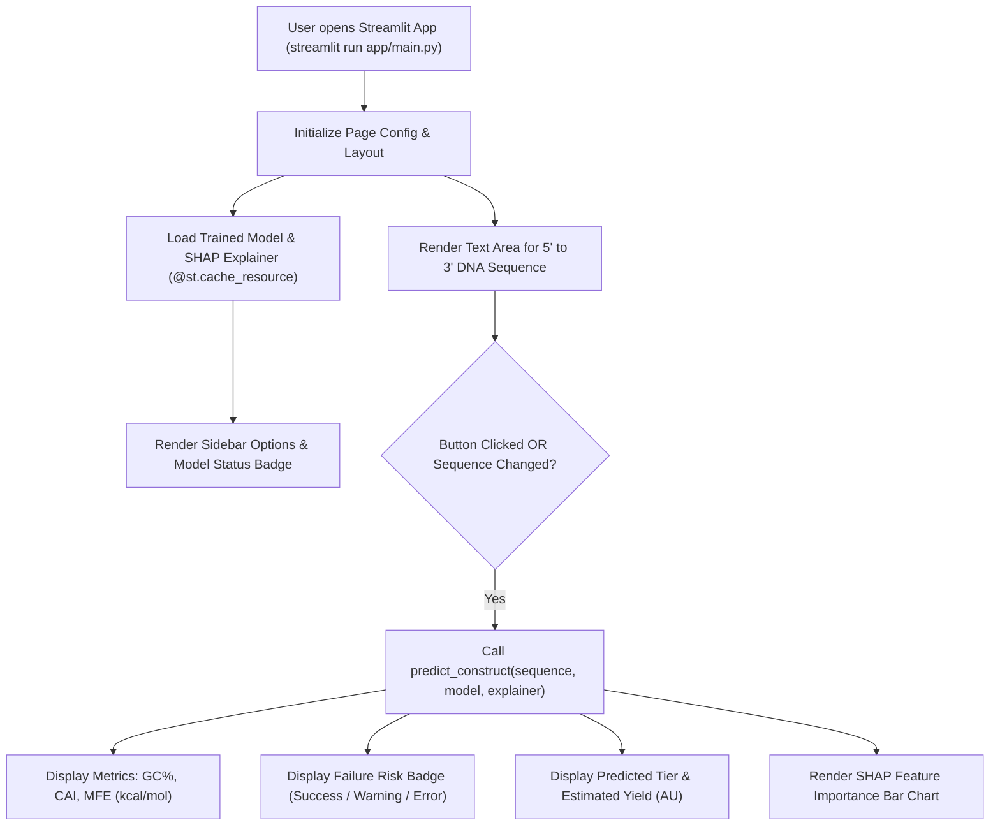
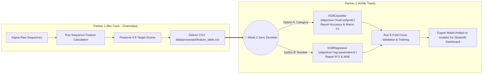

# 📊 SynthBio Architecture & Flow Mermaid Diagrams

This document contains visual Mermaid architectural diagrams for all core subsystems of the **SynthBio** application, including end-to-end data flow, feature engineering routines, ML training & cross-validation, inference risk scoring, Streamlit UI serving, and Partner handoff workflows.

---

## 1. 🌐 Overall System High-Level Data Architecture

---

## 2. 🧬 Feature Engineering Pipeline (`src/features.py`)

---

## 3. 🔄 ML Training & Validation Flow (`src/pipeline.py`)

---

## 4. 🎯 Inference Engine & Failure Risk Calculation (`src/predict.py`)

---

## 5. 🖥️ Streamlit Web Application Interactive Architecture (`app/main.py`)

---

## 6. 🤝 Partner 1 & Partner 2 Data Handoff Sync Workflow

