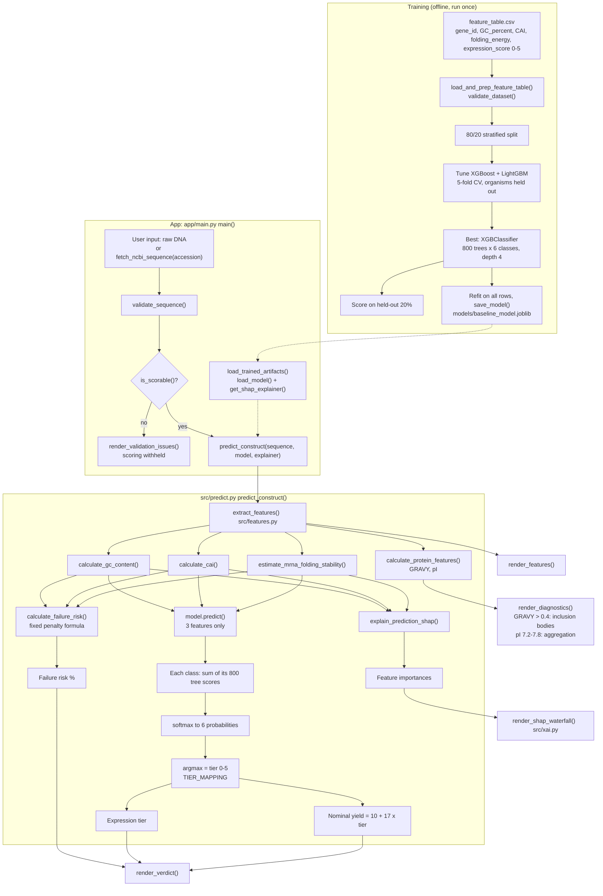

# SynthBio End-to-End Pipeline

This document walks through every box in the pipeline diagram, from the training CSV to what appears on screen in the Streamlit app. The diagram source is [`pipeline_end_to_end.mmd`](pipeline_end_to_end.mmd).



## The big picture

The system has two halves that only meet at one file:

1. **Training** runs once, offline. It turns a table of genes with known expression levels into a saved model file, `models/baseline_model.joblib`.
2. **The app** runs every time someone clicks *Analyse construct*. It turns one DNA sequence into a prediction, using that saved model file.

The dotted arrows in the diagram are the only link between them: the app loads whatever model file training last produced. If no file exists, the app still works but falls back to fixed rules for the tier (see [Fallback mode](#fallback-mode-no-model-file)).

The app produces **three separate outputs**, and they are not computed the same way:

| Output | Computed by | Uses the trained model? |
|---|---|---|
| Expression tier (0–5) | `model.predict()` | Yes |
| Nominal yield | `10 + 17 × tier` | Only indirectly, through the tier |
| Failure risk % | `calculate_failure_risk()` | **No**, a fixed formula |

---

## Part 1: Training (the `TRAIN` box)

### T1: `feature_table.csv`
The training data lives in `data/processed/feature_table.csv`. It has one row per gene (6,348 genes from the Boël et al. 2016 *E. coli* expression study), with these columns:

| Column | Meaning |
|---|---|
| `gene_id` | Gene identifier. The letter prefix (e.g. `AaR`, `BtR`) identifies the source organism. |
| `GC_percent` | Percentage of G and C bases in the gene. |
| `CAI` | Codon Adaptation Index: how closely the gene's codons match those *E. coli* prefers (0 to 1). |
| `folding_energy` | A measure of how tightly the 5' end of the mRNA folds (kcal/mol; more negative means tighter). |
| `expression_score` | The **target**: measured expression tier, 0 (none) to 5 (very high). |

The dataset is not committed to git (`.gitignore` excludes `data/`), so it has to be supplied locally.

### T2: `load_and_prep_feature_table()` and `validate_dataset()`
In `src/data_processing.py`. This reads the CSV, checks every expected column exists, has no missing values and is numeric, then splits it into the feature matrix **X** (`GC_percent`, `CAI`, `folding_energy`) and the target **y** (`expression_score`).

### T3: 80/20 stratified split
20% of the genes are set aside as a **test set** that the model never sees during training or tuning. "Stratified" means each tier appears in the same proportion in both halves, which matters because tier 1 has only 131 genes.

### T4: Tune XGBoost and LightGBM
Both are *gradient-boosted tree* algorithms. Each has settings (number of trees, tree depth, learning rate, and so on) that change how well it learns. Tuning tries 40 random combinations of settings for each algorithm and keeps the best.

Each combination is scored with **5-fold cross-validation**: the training 80% is cut into 5 parts, the model trains on 4 and is scored on the 5th, five times over. The folds are grouped by **organism**, so a gene's relatives are never in both the training and scoring parts. Without that, the model could score well just by recognising organisms (GC content is strongly organism-specific) rather than learning anything about expression.

The score used is **macro-F1**, which averages performance across all 6 tiers equally, so a model can't look good by only ever predicting the most common tier.

### T5: Best model, `XGBClassifier`
The winning settings were XGBoost with 800 trees per tier, a maximum depth of 4, learning rate 0.03, 80% row subsampling and L2 regularisation of 10. Rare tiers were given extra weight during training so the model doesn't ignore them.

### T6: Score on the held-out 20%
The tuned model is scored once on the 1,270 test genes it has never seen. Results:

| Metric | Trained model | Random guessing | Always guess tier 5 |
|---|---|---|---|
| Macro-F1 | 0.20 | 0.17 | 0.08 |
| Accuracy | 25% | ~17% | 31% |

The three features carry only a weak signal about expression tier; their correlations with it are all below 0.09.

### T7: Refit and `save_model()`
Once the settings are chosen and scored, the model is retrained on **all** 6,348 genes (more data is better for the final model) and written to `models/baseline_model.joblib` with `joblib`. This file is also excluded from git.

---

## Part 2: The app (the `APP` box)

All of this lives in `app/main.py`, starting from `main()`.

### A0: `load_trained_artifacts()`
Runs once when the app starts (Streamlit caches it with `@st.cache_resource`). It:
- calls `load_model()` (`src/model.py`) to read `models/baseline_model.joblib`, and
- calls `get_shap_explainer()` to build a SHAP `TreeExplainer` for that model, used later to explain predictions.

If the file is missing or fails to load, both come back as `None` and the app runs in fallback mode. Because of the cache, **the app must be restarted** to pick up a newly trained model.

### A1: User input
Two tabs:
- **Raw DNA sequence**: paste a coding sequence, 5' to 3'.
- **NCBI accession**: enter an ID, and `fetch_ncbi_sequence()` (`src/features.py`) downloads the sequence from NCBI.

### A2: `validate_sequence()`
In `src/validation.py`. It cleans the input (uppercase, strips spaces and line breaks) and checks it for problems. Each problem is either **blocking** (scoring is refused) or **advisory** (a warning is shown, but scoring continues):

| Check | Type |
|---|---|
| No sequence provided | Blocking |
| Non-nucleotide characters | Blocking |
| Ambiguity codes (N, R, Y, ...) | Advisory |
| Length is not a multiple of 3 | Blocking |
| Doesn't start with ATG | Blocking |
| Stop codon before the end | Blocking |
| Shorter than the 48 nt folding window | Blocking |

### A3 / A4: `is_scorable()` and `render_validation_issues()`
`is_scorable()` returns true only if there are no blocking issues. If there are, `render_validation_issues()` shows them and the app stops there, so no number is shown that the input can't support.

### P0: `predict_construct()`
If the sequence passes, it goes to `predict_construct()` in `src/predict.py` along with the model and explainer. Everything in the `PRED` box happens inside this function.

---

## Part 3: Prediction (the `PRED` box)

### F0–F4: `extract_features()`
In `src/features.py`. It calculates five features from the DNA sequence:

| Function | Feature | How it's calculated |
|---|---|---|
| `calculate_gc_content()` | GC % | (count of G + C) ÷ length × 100 |
| `calculate_cai()` | CAI | Geometric mean of each codon's "relative adaptiveness" weight, from a built-in *E. coli* K-12 codon table |
| `estimate_mrna_folding_stability()` | Folding (kcal/mol) | −1.5 × 48 × (GC fraction of the first 48 nt)^1.5. A GC-based estimate, not a real RNA folding calculation. |
| `calculate_protein_features()` | GRAVY | Translates the DNA to protein (Biopython), then the average hydrophobicity |
| `calculate_protein_features()` | pI | The pH at which the translated protein has no net charge |

GC, CAI and folding feed the model and the risk formula. GRAVY and pI are **not** used by either. They only drive the diagnostics (V3).

> **Known mismatch:** the app's CAI and folding calculations don't match how those columns in `feature_table.csv` were produced. In the CSV, CAI ranges 0.61–0.92 and folding −24 to −3. The app gives GFP a CAI of 0.45 and folding of −16.5, typically about twice as negative as the CSV for the same GC. The model is therefore often fed values outside anything it trained on, which makes its predictions unreliable until the two are aligned.

### R1: `calculate_failure_risk()` → Failure risk %
A **fixed formula**, independent of the trained model. It starts at 0 and adds penalties:

| Condition | Penalty |
|---|---|
| GC below 40% or above 60% | 1.5 points for each percentage point outside the range |
| CAI below 0.70 | 60 × (0.70 − CAI) |
| Folding below −12 kcal/mol | 2 points for each kcal/mol below −12 |

The total is capped at 99.9%. Because it ignores the model, the risk and the tier can disagree (e.g. GFP: low risk, 26.2%, but tier 0).

### M0–M3: `model.predict()` → Expression tier
This is the only step that uses the trained model:

1. **M0 (input):** a one-row table of the 3 features the model was trained on. The function reads `model.feature_names_in_` to select exactly those columns.
2. **M1 (trees):** XGBoost holds 800 decision trees for each of the 6 tiers (4,800 in total). Each tree asks up to 4 yes/no questions about the features (e.g. "GC_percent < 52.3?", then "CAI < 0.78?") and lands on a leaf holding a small number. For each tier, the leaf numbers from its 800 trees are added up into one raw score.
3. **M2 (softmax):** the 6 raw scores are turned into 6 probabilities that sum to 1.
4. **M3 (argmax):** the tier with the highest probability wins, and `TIER_MAPPING` gives it a name:

| Tier | Label |
|---|---|
| 0 | Very Low |
| 1 | Low |
| 2 | Medium-Low |
| 3 | Medium |
| 4 | High |
| 5 | Very High |

### OUT3: Nominal yield
Not a separate prediction. It's simply `10 + 17 × tier` (Tier 0 → 10, Tier 5 → 95) to give a number on an arbitrary scale. The app labels it "Not a measured yield".

### S1: `explain_prediction_shap()` → Feature importances
SHAP explains *why* the model chose this tier. For one prediction, it splits the model's output into a contribution from each feature: how much GC, CAI and folding each pushed the score up or down from the average. It uses the same 3 columns as the model.

---

## Part 4: What appears on screen (the bottom row)

| Function | What it shows |
|---|---|
| `render_verdict()` | The headline: risk band (low < 30%, moderate 30–60%, high ≥ 60%), the tier, the nominal yield, the risk %, and a provenance line saying whether a trained model or fallback rules produced the tier, which model, when it was built and which features it used. |
| `render_features()` | The five computed feature values with a short note on each. |
| `render_diagnostics()` | Fixed warnings, independent of the model: **inclusion body risk** if GRAVY > 0.4 (hydrophobic proteins tend to clump), **aggregation risk** if pI is 7.2–7.8 (near *E. coli*'s internal pH the protein has little charge), and an **over-optimisation trap** if CAI > 0.85, folding < −15 and the tier is 2 or lower (heavy codon optimisation raising GC and creating hairpins that block the ribosome). |
| `render_shap_waterfall()` | In `src/xai.py`. A waterfall chart of the SHAP values: starting from the average prediction, each bar shows one feature pushing it toward or away from the predicted tier. Tiers 0–2 are treated as unfavourable outcomes when describing the bars. |

---

## Fallback mode (no model file)

If `models/baseline_model.joblib` doesn't exist, `predict_construct()` skips M0–M3 and uses fixed rules for the tier instead:

| Condition | Tier | Yield |
|---|---|---|
| GC ≥ 45% and CAI ≥ 0.65 | High | 85 |
| GC ≥ 35% and CAI ≥ 0.45 | Medium | 48 |
| Otherwise | Low | 12 |

SHAP is also skipped, and the feature importances are replaced by fixed weights. The failure risk and diagnostics are the same in both modes.

---

## Running it

Train the model (from the repo root, with the virtual environment active):

```
python -m src.pipeline
```

Start the app, and restart it after retraining:

```
streamlit run app/main.py
```

> Note: the repo's `src/pipeline.py` trains with fixed default settings, not the tuned settings described in T4–T5. The tuned model was produced with a separate search script.
